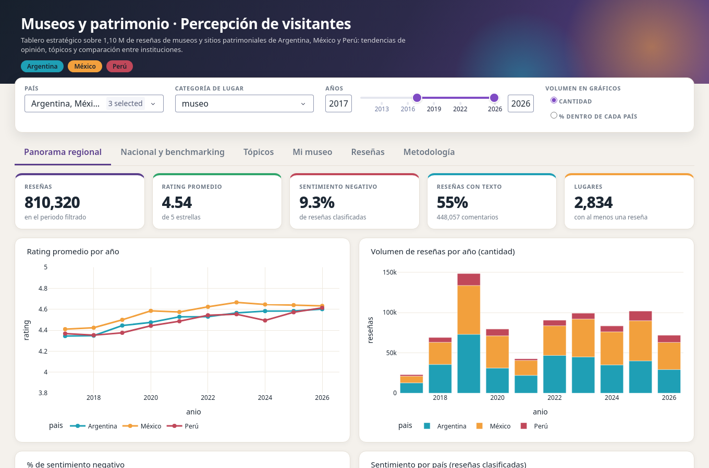
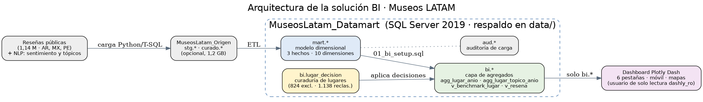
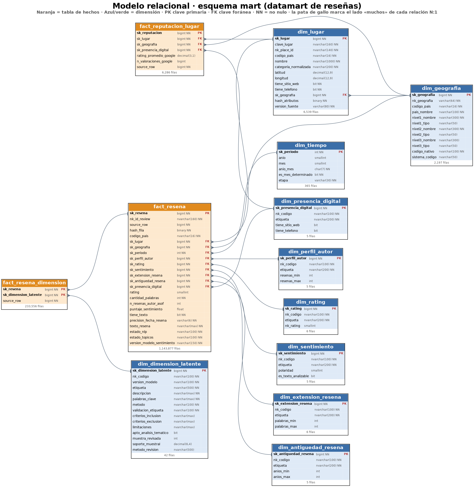

# Grupo4_2026_2_MuseosBIARMXPE

Este repositorio contiene el proyecto final del curso de Business Intelligence (2026-II). Construimos un datamart en SQL Server y un dashboard en Plotly Dash a partir de 1,14 millones de reseñas públicas de Google Maps sobre museos y sitios patrimoniales de Argentina, México y Perú. A cada reseña le asignamos sentimiento y tópico con modelos de NLP. Aquí se encuentra todo el proceso, desde la extracción de las fuentes y la carga ETL hasta el diseño del datamart, el diccionario de datos, la capa BI y el dashboard.

Integrantes: Cordova Delgado, Marietha; Herrera Criollo, Bruno; Minchola Robles, Sebastian.



## Entregables y dónde encontrarlos

| Entregable | Ubicación |
|---|---|
| Fuentes extraídas (fichas de lugares y reseñas de Google Maps, referencias geográficas y consultas) | [`extraccion_y_carga/data/`](extraccion_y_carga/data/README.md) |
| Proceso de extracción (scraping por etapas y NLP) | [`extraccion_y_carga/README_EXTRACCION.md`](extraccion_y_carga/README_EXTRACCION.md) y [`extraccion_y_carga/repos_wrapper/`](extraccion_y_carga/repos_wrapper/README.md) |
| Carga ETL a SQL Server (Python, T-SQL y evidencias de ejecución) | [`extraccion_y_carga/carga_sql_server/`](extraccion_y_carga/carga_sql_server/README.md) |
| Diseño del datamart (constelación de 3 hechos y 10 dimensiones) | [`docs/modelo_datos.md`](docs/modelo_datos.md), [diagrama relacional](docs/img/modelo_relacional_mart.png) y [arquitectura](docs/img/arquitectura.png) |
| Diccionario de datos | Datamart en [`docs/diccionario_analitico.md`](docs/diccionario_analitico.md), esquema físico en [`DICCIONARIO_SQL_SERVER.md`](extraccion_y_carga/carga_sql_server/DICCIONARIO_SQL_SERVER.md) y fuentes en [`diccionario_de_datos.md`](extraccion_y_carga/diccionario_de_datos.md) |
| Depuración del datamart | [`datamart/`](datamart/README.md) |
| Capa BI y curaduría de lugares | [`bi/`](bi/README.md) y [diagrama](docs/img/capa_bi.png) |
| Modelo analítico (ROLAP) y propuesta de mejora | [`docs/modelo_analitico_y_decisiones.md`](docs/modelo_analitico_y_decisiones.md) |
| Dashboard de 6 pestañas | [`dashboard/`](dashboard/app.py), con réplica en [`docker-compose.yml`](docker-compose.yml) |
| Verificación (restauración, 16 pruebas de KPI y revisión de las 6 pestañas) | [`docs/verificacion.md`](docs/verificacion.md) |
| Respaldo del datamart (.bak, 252 MB) | [Release v1.0](https://github.com/bandrehc/museos-latam-bi/releases/tag/v1.0) o carpeta indicada en [`ENLACE_RESPALDO_BAK.txt`](ENLACE_RESPALDO_BAK.txt), con su SHA-256 en [`data/SHA256SUMS.txt`](data/SHA256SUMS.txt) |
| Presentación final | [`ENLACE_PRESENTACION.txt`](ENLACE_PRESENTACION.txt) |

> El archivo .bak supera los 100 MB que GitHub permite por archivo, por eso se publica como adjunto del
> Release v1.0 y también en la carpeta de Drive del equipo. Su SHA-256 es
> `5392c86ac7efa205a5b6a714ecd947ccacdf6dc9499726816224ce6e6a392334`.

## 1. Marco teórico

La inteligencia de negocios convierte los datos de un proceso en información para tomar y evaluar
decisiones. Para este proyecto seguimos el enfoque dimensional de Kimball y Ross (2013), que organiza los
datos en hechos y dimensiones conformadas, y lo preferimos al data warehouse corporativo de Inmon (2005)
porque el alcance es un solo proceso con una fuente principal.

En nuestro datamart la reseña es el hecho atómico, la reputación de cada ficha se registra como una
observación aparte y la pertenencia de una reseña a un tópico se guarda en una tabla puente. Las
dimensiones compartidas permiten comparar países y categorías sin mezclar granos ni promediar promedios.
La capa `bi` guarda numeradores y denominadores aditivos y calcula los ratios al momento de la consulta.

El uso de reseñas en línea para estudiar la experiencia en museos tiene antecedentes en la literatura.
Alexander et al. (2018) analizaron reseñas de TripAdvisor sobre museos de Londres, y Riva y Agostino (2022)
identificaron dimensiones latentes de la experiencia museística con reseñas de la misma plataforma.
Tomamos ambos trabajos como base, con la diferencia de que nuestro corpus proviene de Google Maps.

## 2. Institución, proceso y problemática

Proponemos como usuarios de decisión a los responsables de experiencia y servicios al visitante en museos
y en organismos públicos de patrimonio. El caso de referencia es la gestión museal del Ministerio de
Cultura del Perú, que comparamos de forma exploratoria con instituciones de México y Argentina. Se trata
de un caso académico, sin encargo ni acceso a datos internos de esas instituciones.

El proceso que abordamos consiste en revisar las opiniones públicas, detectar señales de problemas,
priorizar revisiones operativas y dar seguimiento a su evolución. Hoy esas opiniones están dispersas,
tienen categorías y fechas de precisión desigual y no existe una forma reproducible de comparar
instituciones. De ahí surge la pregunta de negocio.

> ¿Qué instituciones y aspectos de la visita requieren revisión prioritaria, considerando volumen,
> comparabilidad y cobertura del análisis automático?

## 3. Del dato crudo al dashboard



1. Extracción. Generamos consultas por división territorial, buscamos lugares con mapScraper y depuramos
   el resultado hasta un universo de 6.538 lugares. Después extrajimos las reseñas con Selenium y las
   consolidamos sin duplicados por `id_review` ([`extraccion_y_carga/`](extraccion_y_carga/README.md)).
2. NLP. El idioma se detectó con Lingua, el sentimiento con Cardiff XLM-T y los 41 tópicos con S-BERT y
   BERTopic.
3. Carga ETL. La carga se hizo con Python y T-SQL, sin SSIS. Es idempotente y reanudable, verifica los
   insumos con SHA-256 y controla la integridad con anti-joins, claves foráneas y restricciones CHECK. Una
   segunda ejecución completa terminó sin diferencias.
4. Depuración. Retiramos las columnas vacías o sin variación, homogeneizamos la geografía y eliminamos la
   dimensión idioma ([`datamart/`](datamart/README.md)).
5. Capa BI y curaduría. Reúne los agregados aditivos, las decisiones sobre lugares y el contrato de
   medidas ([`bi/`](bi/README.md)).
6. Dashboard. La aplicación en Plotly Dash se conecta con un usuario de solo lectura sobre el esquema `bi`
   ([`dashboard/`](dashboard/app.py)).

## 4. Modelamiento dimensional y diccionario

El datamart tiene tres hechos y diez dimensiones organizados como una constelación, con dimensiones
compartidas y una normalización entre geografía y lugar. El [modelo físico](docs/modelo_datos.md) y el
[diccionario analítico](docs/diccionario_analitico.md) describen cada tabla. El datamart conserva las
1.143.877 reseñas, ya que las exclusiones de la curaduría solo se aplican en la capa de consumo.



También están las versiones vectoriales del [modelo relacional](docs/img/modelo_relacional_mart.svg) y de
la [capa BI](docs/img/capa_bi.svg), que se pueden ampliar sin perder calidad.

## 5. Modelo analítico, resultados y propuesta de mejora

La [capa analítica](docs/modelo_analitico_y_decisiones.md) documenta las medidas, las jerarquías y las
operaciones de slice, dice, drill-down y roll-up. La implementamos de forma relacional (ROLAP) con Python,
SQL y Dash, sin un cubo SSAS ni paquetes SSIS.

Después de la curaduría quedan 1.096.044 reseñas de 4.172 lugares, frente a las 1.143.877 del datamart.
Se excluyeron 47.833 reseñas, alrededor del 4,18 %. El corpus tiene 233.556 asignaciones de tópico y,
según la revisión semántica por muestreo, 22 de los 41 tópicos se usan en los indicadores.

Proponemos un piloto de tres acciones. La primera es revisar los comentarios con ratings bajos y
sentimiento negativo de una institución elegida por su comparabilidad. La segunda es validar las
etiquetas de los tópicos con dos revisores antes de intervenir a partir de ellas. La tercera es mejorar la
comunicación de horarios y precios en un museo, solo si los comentarios revisados lo justifican. El
[plan](docs/modelo_analitico_y_decisiones.md) detalla responsables y esfuerzo estimado. Estas acciones son
una propuesta y todavía no se han implementado.

## 6. Conclusiones

La solución une datos reales, un modelo dimensional y una visualización navegable, de modo que se pueden
contrastar las medidas cuantitativas con las señales del texto. Como la curaduría cambia el universo
analítico, conviene distinguir el total recolectado del que usa el dashboard. El ranking depende del
período, la categoría, el país y el mínimo de reseñas, así que indica la posición de cada lugar frente a
sus pares. La cobertura temática y las fechas estimadas también limitan la lectura de los resultados. Con
estas condiciones, el dashboard sirve para formular hipótesis operativas y priorizar revisiones, aunque sus
resultados no permiten medir efectos causales.

## 7. Recomendaciones

Recomendamos validar las etiquetas de tópicos y de sentimiento con revisores humanos de cada país antes de
tomar decisiones basadas en un tópico. También conviene conservar en la base de origen el idioma, las
probabilidades y las versiones de los modelos aunque el panel no las muestre. Como la carga es idempotente,
la extracción se puede actualizar de forma periódica, y el modelo se puede extender a otros países con la
misma configuración geográfica.

## Cómo replicarlo

Descargue el respaldo desde el [Release v1.0](https://github.com/bandrehc/museos-latam-bi/releases/tag/v1.0)
o desde la carpeta indicada en [`ENLACE_RESPALDO_BAK.txt`](ENLACE_RESPALDO_BAK.txt) y guárdelo en `data/`
con su nombre original, `MuseosLatam_Datamart_depurado_20261108.bak`. Para verificar el hash use
`sha256sum -c data/SHA256SUMS.txt` en Linux o macOS (desde `data/`) o
`Get-FileHash data\MuseosLatam_Datamart_depurado_20261108.bak` en PowerShell.

### Opción A. Docker (recomendada)

Se necesita Docker con Compose, unos 4 GB de RAM libres para SQL Server, unos 8 GB de disco y conexión a
internet la primera vez, para descargar las imágenes y librerías.

```bash
cp .env.example .env          # cambie las dos contraseñas (SQL Server exige mayúscula, minúscula, número y símbolo)
docker compose up --build     # restaura el datamart, crea el usuario de solo lectura, construye la capa BI y levanta el dashboard
```

Luego abra http://localhost:8050. La primera vez la restauración tarda unos 2 a 3 minutos y las siguientes
solo segundos, porque la base queda guardada en el volumen `sqldata`. SQL Server también queda disponible
en `localhost,14330` (usuario `sa`) para SSMS o Azure Data Studio, y `docker compose down -v` elimina todo.

### Opción B. SQL Server instalado (Windows o Linux) y Python

1. Restaure el .bak con `scripts/restaurar_datamart.sql`, editando solo la ruta, o desde SSMS. Se requiere
   SQL Server 2019 o posterior.
2. Instale Python 3.12 o superior y defina las variables de entorno (en PowerShell se usa `$env:NOMBRE="valor"`).
   ```bash
   pip install -r requirements.txt
   export MUSEOS_DB_HOST=127.0.0.1 MUSEOS_DB_PORT=1433 MUSEOS_ADMIN_USER=sa
   export MUSEOS_ADMIN_PASS='<clave de sa>' DASHLY_RO_PASSWORD='<clave nueva para el usuario de solo lectura>'
   python deploy/init_db.py              # crea el usuario dashly_ro, reconstruye bi.* y verifica la reconciliación
   export MUSEOS_DB_PASS="$DASHLY_RO_PASSWORD"
   python dashboard/app.py               # http://127.0.0.1:8050
   ```
3. Ejecute `python tests/test_kpis.py`, que debe terminar con las 16 pruebas en OK.

Las pruebas que no necesitan SQL se ejecutan con `python -m unittest discover -s tests -p test_metricas.py -v`
(7 casos). Con la base disponible, `python scripts/verificar_entrega.py` ejecuta 9 controles del datamart y
genera un reporte JSON como el de [`docs/evidencias/control_entrega.json`](docs/evidencias/control_entrega.json).

### Cómo comprobar que la réplica es fiel

- La vista `bi.v_control_reconciliacion` debe devolver `ok = 1` y el dashboard debe mostrar 1.096.044 reseñas en 4.172 lugares.
- Con el filtro por defecto, la pestaña Panorama muestra 810.320 reseñas, 4,54 estrellas, 9,3 % de sentimiento negativo, 55 % de reseñas con texto y 2.834 lugares.
- Los resultados de referencia de todas las pruebas están en [`docs/verificacion.md`](docs/verificacion.md).

## Estructura del repositorio

```
README.md                  este documento
ENLACE_PRESENTACION.txt    enlace a la presentación final
ENLACE_RESPALDO_BAK.txt    enlace a la carpeta con el .bak
docker-compose.yml         réplica completa con SQL Server 2019, restauración y dashboard
Dockerfile, requirements.txt, .env.example
data/                      SHA-256 del respaldo (el .bak se descarga y se coloca aquí)
datamart/                  depuración y homogeneización aplicadas al datamart (ya incluidas en el .bak)
bi/                        capa BI (00_decisiones_setup.sql, 01_bi_setup.sql) y curaduría de lugares
dashboard/                 app.py y metricas.py (Plotly Dash), assets/ con estilos y ajustes móviles
deploy/                    init_db.py para la restauración e inicialización automática
tests/                     pruebas de reconciliación de KPI (16, con SQL) y de métricas (7, sin SQL)
scripts/                   restaurar_datamart.sql, verificar_entrega.py y generar_diagramas.py
docs/                      modelo de datos, diccionario analítico, modelo analítico, verificación, diagramas y evidencias
extraccion_y_carga/        extracción, fuentes extraídas, NLP y carga ETL a SQL Server (ver su README)
```

## Decisiones de diseño

- El respaldo entregado ya incluye la depuración. Se retiraron 14 columnas sin información, las
  probabilidades por clase de sentimiento y la dimensión idioma, porque el detector fallaba en textos
  cortos (el idioma detectado se conserva en la base de origen). La inicialización no vuelve a ejecutar
  esos scripts. Más detalle en [datamart/README.md](datamart/README.md).
- Muchos lugares del universo no eran museos, como plazas, comercios u hoteles. Revisamos 2.381 lugares y
  decidimos excluir 824, que suman el 4,18 % de las reseñas, reclasificar 1.138 y mantener 419. Nada se
  borra de `mart`, ya que las decisiones se guardan en `bi.lugar_decision` y se pueden volver a aplicar
  con `bi/decisiones_vigentes.csv` ([bi/README.md](bi/README.md)).
- Solo 22 de los 41 tópicos se usan en los indicadores. Los 19 de uso restringido se explican en la pestaña
  Metodología del dashboard.
- Para no favorecer a los lugares con pocas reseñas, el ranking usa un rating suavizado con un prior de 20
  reseñas y un percentil calculado frente a pares con al menos 30 ratings.

## Limitaciones

- Las reseñas son autoseleccionadas y la cobertura varía entre países. Reflejan las opiniones publicadas y
  no permiten medir la asistencia ni atribuir causas.
- El 89 % de las fechas solo tiene precisión anual, por lo que las series se presentan por año.
- El sentimiento y los tópicos se obtuvieron de forma automática. La revisión de los tópicos se hizo por
  muestreo, con un modelo de lenguaje como anotador y sin validación humana, y sus porcentajes describen
  la muestra revisada.
- La vista `mart.v_fuente_lugar` consulta la base de origen, que no forma parte de la entrega (1,2 GB) y que
  el dashboard no necesita.
- El mapa base del dashboard necesita conexión a internet.

## Seguridad y datos

El dashboard se conecta con el usuario `dashly_ro`, que solo puede leer el esquema `bi` y no tiene acceso a
las tablas de decisiones. Las contraseñas se definen en `.env`, un archivo excluido del repositorio, y no se
entregan credenciales. El dashboard tampoco muestra a los autores de las reseñas. Las fuentes de
`extraccion_y_carga/data/` son reseñas públicas de Google Maps tal como se recolectaron y se conservan para
la trazabilidad académica del proyecto.

## Referencias

Alexander, V. D., Blank, G., & Hale, S. A. (2018). TripAdvisor reviews of London museums: A new approach to understanding visitors. *Museum International, 70*(1-2), 154–165. https://doi.org/10.1111/muse.12200

Inmon, W. H. (2005). *Building the data warehouse* (4th ed.). Wiley.

Kimball, R., & Ross, M. (2013). *The data warehouse toolkit: The definitive guide to dimensional modeling* (3rd ed.). Wiley.

Riva, P., & Agostino, D. (2022). Latent dimensions of museum experience: Assessing cross-cultural perspectives of visitors from TripAdvisor reviews. *Museum Management and Curatorship, 37*(6), 616–640. https://doi.org/10.1080/09647775.2022.2073560
