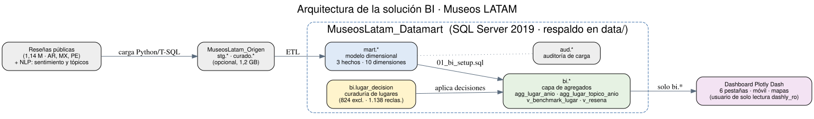
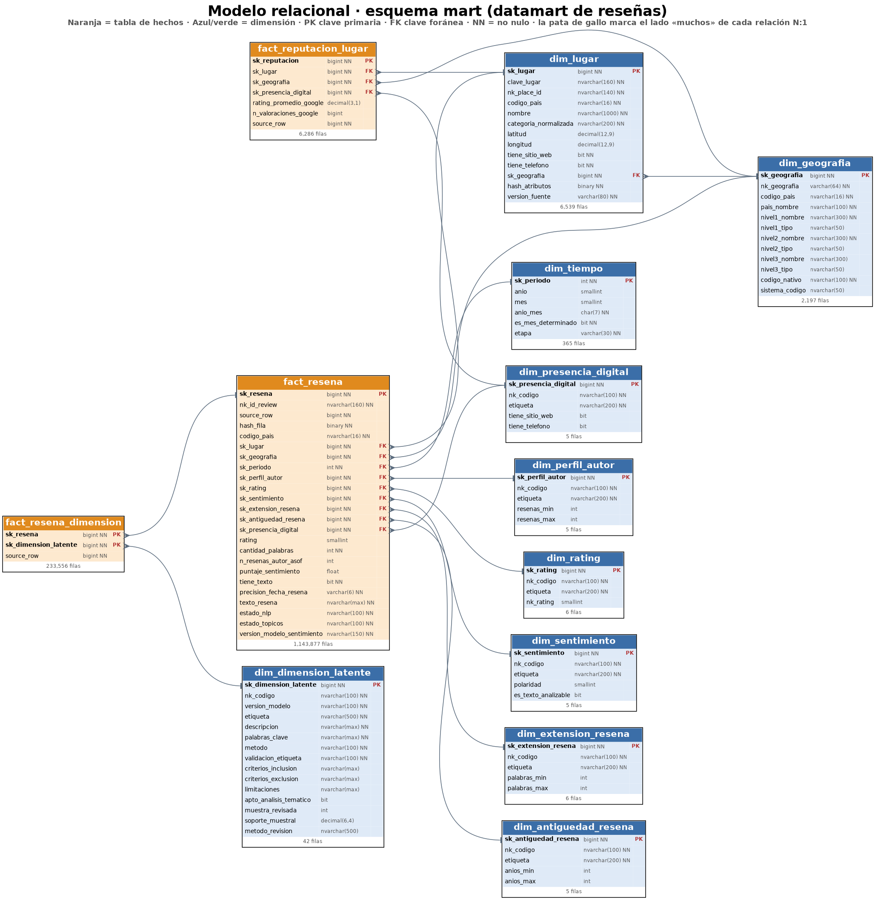
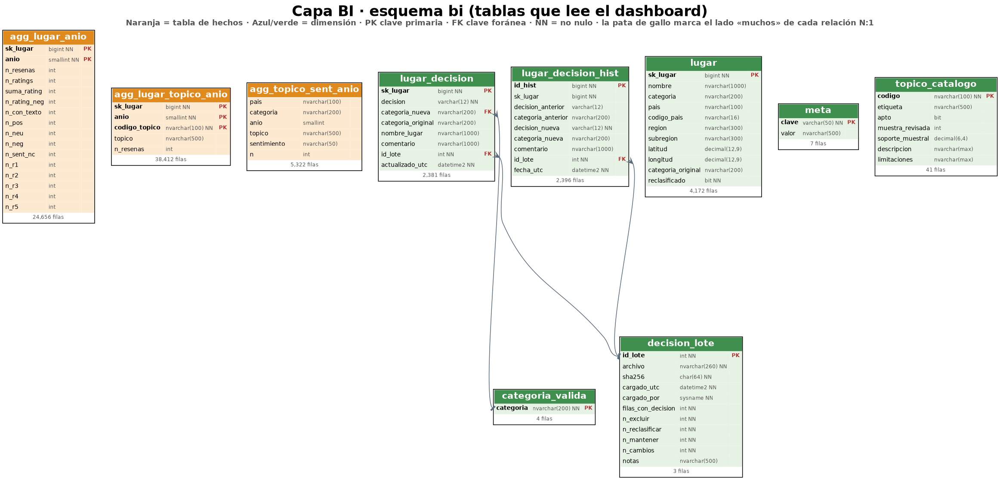

# Modelo de datos

## Esquema `mart` (datamart dimensional)
Constelación con **tres hechos** (uno puente) y dimensiones compartidas; la FK geografía → lugar incorpora normalización tipo copo de nieve. Cada hecho conserva su grano. Diagrama completo del datamart entregado (columnas, tipos, PK/FK y filas): [`img/modelo_relacional_mart.svg`](img/modelo_relacional_mart.svg) · [`.png`](img/modelo_relacional_mart.png).

| Tabla | Tipo | Grano (una fila por…) | Filas |
|---|---|---|---:|
| `fact_resena` | Hecho | reseña publicada (rating, sentimiento, texto, estados NLP) | 1.143.877 |
| `fact_resena_dimension` | Hecho puente N:M | pertenencia reseña ↔ tópico latente | 233.556 |
| `fact_reputacion_lugar` | Hecho | ficha de lugar con métricas publicadas (rating y n.º de valoraciones) | 6.286 |
| `dim_lugar` | Dimensión | lugar (museo o sitio patrimonial), con coordenadas y categoría | 6.539 |
| `dim_geografia` | Dimensión | unidad territorial (3 niveles; el 3.º solo en Perú) | 2.197 |
| `dim_tiempo` | Dimensión | período (año o año-mes; el 89 % de las fechas solo tiene año) | 365 |
| `dim_sentimiento`, `dim_rating` | Dimensiones | etiqueta de sentimiento / nivel de estrellas | 5 / 6 |
| `dim_perfil_autor`, `dim_extension_resena`, `dim_antiguedad_resena`, `dim_presencia_digital` | Dimensiones | bandas de perfil del autor, longitud del texto, antigüedad y presencia digital del lugar | 5–6 |
| `dim_dimension_latente` | Dimensión | tópico del modelo NLP (41 + desconocido), con definición, criterios y si es apto para indicadores | 42 |

Convenciones: `sk_*` clave sustituta, `nk_*` clave natural; el miembro **-1 = desconocido** existe en las dimensiones. El esquema admite N:M; el modelo de tópicos asigna un solo tópico dominante por reseña asignada. 22 de los 41 tópicos son aptos para indicadores según la revisión semántica por muestreo; 19 son de uso restringido. La revisión usó un modelo de lenguaje como anotador sobre muestras por país y tópico, sin validación humana.

Vistas de consumo: `v_resena_completa`, `v_kpi_museo`, `v_tendencia_anual`, `v_tendencia_mensual`, `v_catalogo_topicos`, `v_cobertura_tematica`, `v_dimension_satisfaccion(_revisada)`, `v_reputacion_territorial`, `v_fuente_lugar` (esta consulta la base de origen, que no se entrega: es la única vista que requiere `MuseosLatam_Origen`).

## Esquema `bi` (lo único que lee el dashboard)
Se reconstruye por completo con `bi/01_bi_setup.sql` a partir de `mart` y de las decisiones de curaduría. 

- `bi.lugar`: lugares efectivos (sin excluidos; categoría ya reclasificada). `agg_lugar_anio`, `agg_lugar_topico_anio`, `agg_topico_sent_anio`: agregados ligeros.
- Vistas: `v_benchmark_lugar` (rating suavizado con prior de 20 reseñas y percentil entre pares con ≥30 ratings), `v_resena`, `v_pais_anio`, `v_topico_pais_anio`, `v_control_reconciliacion` (debe dar `ok = 1`).
- Curaduría: `lugar_decision` (estado vigente), `lugar_decision_hist` y `decision_lote` (auditoría). El usuario del dashboard no puede leerlas.

## Esquema `aud`
Auditoría de la carga del ETL (lotes, ejecuciones, fuentes, incidencias).

## Regenerar los diagramas
`python scripts/generar_diagramas.py` (lee el esquema real; requiere Graphviz y `MUSEOS_ADMIN_PASS`).
