# Extracción, fuentes y carga a SQL Server

Esta carpeta contiene todo lo que ocurre **antes** del datamart depurado y del dashboard de la raíz del repositorio:
la extracción de fichas y reseñas públicas de Google Maps, las fuentes extraídas, el procesamiento NLP
(idioma, sentimiento y tópicos) y la carga ETL a SQL Server (bases `MuseosLatam_Origen` y `MuseosLatam_Datamart`).

Los scripts resuelven sus rutas respecto de esta carpeta (`PROJECT_ROOT = parent.parent`), así que se ejecutan

```mermaid
flowchart LR
    Q[Consultas por país y división territorial] --> S[Búsqueda de lugares · mapScraper]
    S --> U[Depuración: universo de 6.538 lugares]
    U --> R[Extracción de reseñas · Selenium]
    R --> C[Consolidación PE/MX/AR · deduplicación por id_review]
    C --> N[NLP: idioma, sentimiento, 41 tópicos]
    N --> L[Carga Python/T-SQL a SQL Server]
    L --> D[(MuseosLatam_Datamart)]
    D --> P[Depuración y capa BI · raíz del repo]
```

desde aquí: `cd extraccion_y_carga` y luego `python repos_wrapper/<script>.py`.



## Resultado de la extracción

| Indicador | Perú | México | Argentina | Total |
|---|---:|---:|---:|---:|
| Lugares en el universo | 1.662 | 2.751 | 2.125 | 6.538 |
| Lugares con reseñas recolectadas | 1.160 | 1.970 | 1.866 | 4.996 |
| Reseñas | 121.955 | 560.328 | 461.594 | 1.143.877 |
| Reseñas con texto | 60.943 | 270.051 | 292.344 | 623.338 |
| Reseñas con tópico asignado | 23.771 | 102.508 | 107.277 | 233.556 |

Fuente: [controles del corpus](docs/controles_corpus/validacion_final.json) y [evidencia de la carga](carga_sql_server/evidencia_final.json).
Se preservan las 520.539 reseñas sin texto y los 945 ratings ausentes. Las opiniones son autoseleccionadas: no
representan a todos los visitantes ni permiten atribuir causalidad.

## Estructura

```text
README_EXTRACCION.md       proceso de extracción: etapas, herramientas, resultado por país, controles y limitaciones
diccionario_de_datos.md    diccionario de las fuentes extraídas (reseñas, lugares y cobertura)
data/                      fuentes extraídas (ver data/README.md)
  referencia/              configuración de países, taxonomías, consultas de búsqueda y geografía
  lugares/                 fichas de lugar por país: candidatos, identificados, descartados y universo
  resenas/                 reseñas extraídas (CSV y paquetes .csv.gz < 100 MB) y cobertura por lugar
repos/                     repositorios base de scraping (mapScraper, googlemaps-reviews-scraper-es) con sus licencias
repos_wrapper/             scripts propios por etapa: consultas, búsqueda, depuración, reseñas, consolidación y NLP
carga_sql_server/          ETL a SQL Server: DDL, cargador Python, diccionario físico, informe y evidencias de ejecución
  revision_ia_v1/          revisión semántica de tópicos y sentimiento por muestreo
docs/controles_corpus/     manifiesto SHA-256 de los seis CSV finales, auditoría técnica y controles por país y tópico
notebooks/                 análisis exploratorio (EDA) de la base de museos y sus reseñas
tests/                     pruebas de contratos y regresión del pipeline
```

## Fuentes extraídas

- **Reseñas.** `data/resenas/paquetes/comentarios_museos_consolidado.csv.gz` es el consolidado de Perú y Argentina
  (583.549 reseñas; columnas `corrida`, `registro_completo` y `pais` añadidas). `comentarios_museos_crudo_argentina.csv.gz`
  es la extracción de Argentina; `comentarios_museos_crudo.csv` y `resenas_museos_consolidadas.csv(.parquet)` son la
  primera corrida de Perú.
  Encabezado común: `google_place_id, nombre_lugar, categoria_google, distrito, provincia, departamento, id_review,
  caption, relative_date, review_date, retrieval_date, rating, username, n_review_user, url_user, url_source`.
- **Lugares.** `data/lugares/base_museos_<pais>.csv` es el universo depurado de cada país; los archivos
  `lugares_identificados*` y `lugares_descartados*` documentan la depuración.
- **Referencias.** Consultas de búsqueda, divisiones territoriales (UBIGEO de Perú, estados de México, provincias
  de Argentina) y taxonomía de categorías.

El corpus final con NLP (1.143.877 filas, seis CSV con SHA-256 en
[validacion_final.json](docs/controles_corpus/validacion_final.json)) supera el límite de GitHub; su contenido
completo está cargado en el respaldo `.bak` enlazado desde el [README principal](../README.md).

## Carga a SQL Server (ETL)

El cargador [`carga_sql_server/cargar.py`](carga_sql_server/cargar.py) verifica los hashes de los seis CSV,
carga `MuseosLatam_Origen` (`stg`, `curado`, `aud`) por lotes con checkpoint transaccional y construye
`MuseosLatam_Datamart` (`mart`, `aud`). Un bloqueo (`sp_getapplock`) impide dos escritores; ante un fallo se
reanuda desde el último lote confirmado, sin truncar tablas. La segunda ejecución completa produjo delta 0 en
las 14 tablas. Detalle: [INFORME_EJECUCION.md](carga_sql_server/INFORME_EJECUCION.md) ·
[instrucciones de ejecución](carga_sql_server/README.md) · diccionario físico:
[DICCIONARIO_SQL_SERVER.md](carga_sql_server/DICCIONARIO_SQL_SERVER.md).

Después de esta carga se aplicaron la depuración y homogeneización del datamart (`../datamart/`) y la capa BI
(`../bi/`); el resultado es el respaldo depurado que usa el dashboard.

## NLP y revisión semántica

- Idioma: Lingua. Sentimiento: Cardiff XLM-T (ONNX int8), calculado sobre el texto, no sobre las estrellas.
- Tópicos: S-BERT MiniLM-L12-v2 + UMAP + HDBSCAN (BERTopic), 41 tópicos entrenados en PE/MX y aplicados sin
  reentrenar a AR. 233.556 asignaciones (37,47 % de las reseñas con texto).
- La revisión semántica por muestreo (488 casos temáticos y 54 de sentimiento) dejó 22 tópicos aptos para
  indicadores y 19 de uso restringido: [revisión](carga_sql_server/revision_ia_v1/README.md) ·
  [informe con los 41 tópicos](carga_sql_server/revision_ia_v1/INFORME_REVISION_IA.md).

## Pruebas sin corpus ni modelos

```powershell
python -m pip install -r tests/requirements.txt
python -B -m unittest discover -s tests -p test_consolidation_preserves_final.py -v
python -B -m unittest discover -s tests -p test_fases12.py -v
python -B -m unittest discover -s tests -p test_topicos_comparacion.py -v
python -B -m unittest discover -s tests -p test_revision_ia_artifacts.py -v
python -B -m unittest discover -s repos_wrapper/latam_ampliacion -p test_pipeline.py -v
```

Cada suite se ejecuta en su propio proceso.

## Seguridad

Los perfiles de Chrome con sesión de Google, `config.json`/`connection.json` y cualquier `.env` están excluidos por
`.gitignore` y nunca se versionan.
