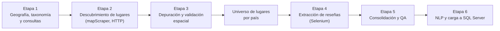

# Proceso de extracción: Perú, México y Argentina

Este documento describe cómo se obtuvo el corpus que alimenta el datamart: herramientas, etapas, resultado por
país, controles de calidad y limitaciones. La descripción de cada variable está en el
[diccionario de datos](diccionario_de_datos.md).

**Resultado:** 1.143.877 reseñas (PE 121.955 · MX 560.328 · AR 461.594) de 4.996 lugares con reseñas, dentro de
un universo de 6.538 lugares. Incluye 623.338 reseñas con texto, 520.539 sin texto y 945 sin rating.

## 1. Etapas

| Etapa | Objetivo | Código (`repos_wrapper/`) | Salida principal |
|---|---|---|---|
| 1 | Geografía, taxonomía y consultas de búsqueda | `build_queries.py`, `prepare_mexico_geography.py`, `prepare_argentina_geography.py`, `country_config.py` | `data/referencia/queries_busqueda*.csv` |
| 2 | Descubrir lugares por consulta | `run_full_search.py`, `run_search_batch.py` | candidatos por país |
| 3 | Deduplicar, validar espacialmente y clasificar | `process_lugares_etapa3.py`, `auditar_base_museos.py`, `export_revision_riesgo.py` | `data/lugares/lugares_identificados*`, `lugares_descartados*`, `base_museos_<pais>.csv` |
| 4 | Extraer las reseñas de cada lugar | `scrape_comentarios_museos.py`, `scrape_museos_ii.py`, `scrape_museos_v2.py`, `scrape_qorikancha.py` | `data/resenas/comentarios_museos_crudo*` |
| 5 | Consolidar, deduplicar y validar | `consolidar_corpus.py`, `consolidate_latam.py`, `validar_latam.py`, `empaquetar_resenas.py` | `data/resenas/paquetes/*.csv.gz`, `cobertura_museos_por_lugar*.csv` |
| 6 | Idioma, sentimiento, tópicos y carga | `fases12/`, `latam_ampliacion/`, `topicos_comparacion/`, `../carga_sql_server/` | bases `MuseosLatam_Origen` y `MuseosLatam_Datamart` |

Cada etapa persiste su estado en SQLite: relanzar el mismo comando retoma solo lo pendiente y no duplica lo guardado.
Dependencias: `python -m pip install -r repos_wrapper/requirements_windows.txt`.

## 2. Herramientas base

Se usaron dos repositorios de código abierto, incluidos en `repos/` con sus licencias, sin claves de API:

- **mapScraper**: recibe una consulta de texto (por ejemplo, "museos en Cusco, Perú") y devuelve lugares con
  enlace de Google Maps, coordenadas, categoría, promedio de estrellas y conteo de reseñas, mediante solicitudes HTTP.
- **googlemaps-reviews-scraper-es**: recibe el enlace de un lugar y devuelve sus reseñas (texto, calificación,
  fecha relativa y datos públicos del autor) mediante Selenium y Google Chrome.

Al segundo se le aplicaron correcciones de robustez: lugares sin control de ordenamiento, cierre garantizado del
navegador, *user agent* acorde al navegador real, uso de un perfil de Chrome con sesión iniciada (sin sesión,
Google Maps muestra solo 5 reseñas por lugar) y un extractor incremental para lugares de volumen muy alto.

## 3. Resultado por país

| Indicador | Perú | México | Argentina | Total |
|---|---:|---:|---:|---:|
| Lugares en el universo | 1.662 | 2.751 | 2.125 | 6.538 |
| Lugares con reseñas | 1.160 | 1.970 | 1.866 | 4.996 |
| Reseñas | 121.955 | 560.328 | 461.594 | 1.143.877 |
| Reseñas con texto | 60.943 | 270.051 | 292.344 | 623.338 |

- **Perú.** Geografía de los 1.893 distritos del catálogo UBIGEO y límite nacional de geoBoundaries. Una
  taxonomía de 15 palabras clave, agrupadas en cuatro categorías (`museo`, `sitio_arqueologico`,
  `sitio_interes_historico`, `patrimonio_religioso`), generó 31.710 consultas en tres niveles territoriales. El
  descubrimiento produjo 18.692 lugares únicos; tras deduplicar, descartar los lugares fuera del polígono nacional
  y asignar el distrito real por coordenadas, quedaron 13.253 lugares identificados. Las reseñas se extrajeron en
  cuatro corridas sucesivas sobre el universo de museos y sitios patrimoniales.
- **México.** Insumos geográficos de geoBoundaries (32 entidades, 2.457 municipios y alcaldías) y 37.335 consultas.
  El universo es la categoría exacta "Museo" de Google: 2.751 lugares en las 32 entidades. La extracción nacional
  usó tres navegadores concurrentes con estado aislado por país.
- **Argentina.** 2.740 consultas por provincia y departamento devolvieron 4.726 lugares únicos; el universo
  depurado tiene 2.125 lugares. La extracción se hizo con un perfil de Chrome con sesión de Google iniciada.

Los criterios de categoría difieren entre países: México usa la categoría exacta "Museo" y Perú y Argentina
incluyen subcategorías patrimoniales. La capa BI homogeneiza las categorías mediante la curaduría de lugares
(ver [`../bi/README.md`](../bi/README.md)).

## 4. Controles de calidad y trazabilidad

- **Deduplicación.** La clave de una reseña es `google_place_id + id_review`; el consolidado de los tres países se
  deduplica por `id_review`.
- **Cobertura.** Cada país genera una fila por lugar con estado, intentos, último error y reseñas obtenidas
  (`cobertura_museos_por_lugar*.csv`).
- **Validación automática.** `validar_latam.py` verifica esquema, unicidad de claves, categoría, rangos de
  calificación, parseo de fechas, integridad referencial contra la base de lugares y estados admitidos.
- **Integridad del corpus final.** Los seis CSV que se cargan a SQL Server tienen SHA-256 publicados en
  [`docs/controles_corpus/validacion_final.json`](docs/controles_corpus/validacion_final.json).

## 5. Limitaciones

- **La fecha de la reseña es una estimación.** Google publica una etiqueta relativa (por ejemplo, "hace 6 meses");
  la fecha se calcula restándola de la fecha de extracción. El 89 % de las reseñas solo admite precisión anual.
- **Dos conteos de reseñas.** El conteo del listado de búsqueda no es el techo de extracción; el panel del lugar
  sirve un conteo menor o distinto, que es el denominador válido de cobertura.
- **Reseñas sin texto.** El 45,5 % de las reseñas solo tiene calificación; todo indicador de texto declara su denominador.
- **Fichas duplicadas.** Algunos lugares físicos tienen dos fichas de Google con las mismas reseñas; el datamart
  deduplica por `id_review`.
- **Universo definido por categorías de Google.** Incluye entradas que no son museos (plazas, comercios, hoteles);
  por eso la capa BI aplica la curaduría de lugares.
- **Datos personales.** `username` y `url_user` corresponden a perfiles públicos. No se infieren atributos
  personales y el dashboard no muestra autores.
- **Uso de plataformas.** La extracción automatizada depende de una interfaz que cambia sin aviso y puede
  contravenir las condiciones de servicio de la plataforma; los resultados se interpretan junto con su cobertura.
